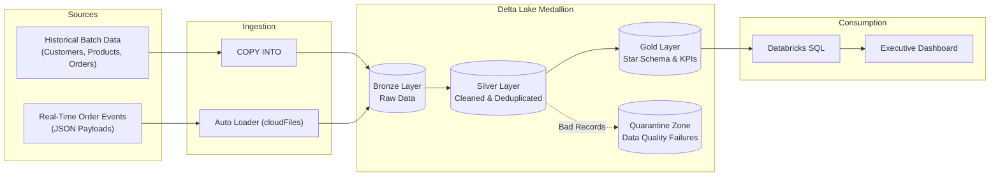

# RetailPulse – End-to-End Retail Data Engineering & Lakehouse Analytics Platform

RetailPulse is an enterprise-grade lakehouse analytics platform built on **Databricks**, **Delta Lake**, **PySpark**, and **Unity Catalog**. It seamlessly processes historical batch transactions and live streaming order events using the **Medallion Architecture (Bronze -> Silver -> Gold)**.

---

## 🏗️ High-Level System Architecture



---

## 📁 Repository Structure

```text
RetailPulse-Lakehouse-Platform/
├── README.md                          # Project documentation
├── .gitignore                         # Standard git ignore rules
├── docs/                              # Architecture diagrams and data dictionary
│   ├── architecture/
│   └── data_dictionary/
├── notebooks/                         # Databricks PySpark & SQL notebooks
│   ├── 01_bronze/                     # Raw ingestion notebooks
│   ├── 02_silver/                     # Data cleaning, deduplication & quarantine
│   ├── 03_gold/                       # Dimensional modeling (Star Schema) & KPIs
│   ├── 04_streaming/                  # Auto Loader streaming pipelines
│   └── 05_orchestration/             # Databricks Workflows configuration
├── src/                               # Reusable Python scripts
│   ├── generators/                    # Synthetic data generation scripts
│   └── utils/                         # Logging, quality checks & helpers
├── sql/                               # Databricks SQL scripts & DDLs
│   ├── ddl/
│   └── analytics/
└── tests/                             # Data quality & pipeline validation tests
```

---

## 🎯 Tech Stack
- **Compute & Platform:** Databricks Workspace (Free Edition / Serverless)
- **Data Governance:** Unity Catalog (Catalogs, Schemas, Volumes)
- **Data Lake Format:** Delta Lake (ACID, Time Travel, Schema Enforcement)
- **Processing Engine:** Apache Spark / PySpark
- **Ingestion Mechanisms:** COPY INTO & Auto Loader (`cloudFiles`)
- **Orchestration:** Databricks Workflows (Multi-task DAGs)
- **Analytics & BI:** Databricks SQL & Native Lakehouse Dashboards
